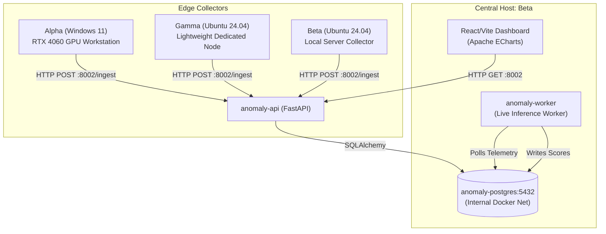

# Home Lab Anomaly / Observability Agent

A lightweight, local-first machine learning infrastructure observability system for a heterogeneous multi-node home lab environment.

---

## 1. Project Purpose & High-Level Architecture

The goal of this system is to provide reliable telemetry ingestion, real-time monitoring, and unsupervised machine learning anomaly detection across three home lab nodes operating on diverse hardware and operating systems:



### Node Roles & Hardware Matrix
* **Alpha (Windows 11):** Daily driver & ML development workstation. Equipped with an Intel CPU, 32GB RAM, and NVIDIA GeForce RTX 4060. Monitors GPU utilization & VRAM via NVML. Employs scheduled collection; intermittent availability (shuts down or sleeps during off hours). Load averages are structurally unavailable (`null`) on Windows.
* **Beta (Ubuntu 24.04 Server):** Primary 24/7 server and central coordinator. Hosts PostgreSQL (`anomaly-postgres`), FastAPI ingestion engine (`anomaly-api`), and the continuous live inference service (`anomaly-worker`).
* **Gamma (Ubuntu 24.04):** Dedicated network services node running standard Linux collectors via `systemd`. Characterized by a persistent single-threaded baseline workload (1 core saturated ~25% aggregate CPU).

---

## 2. Telemetry Pipeline & Data Flow

1. **Edge Sampling:** Lightweight collectors run every 30 seconds on each node using `psutil` (and `pynvml` on Alpha).
2. **Missingness Handling:** Hardware-specific or structurally absent sensors (e.g., Windows load averages, non-GPU systems) serialize cleanly as `null` without crashing.
3. **Ingestion & Storage:** Telemetry payloads are submitted via `POST /ingest` to `anomaly-api`, validated against Pydantic schemas, and stored in the `node_metrics` PostgreSQL table.
4. **Live Inference:** The `anomaly-worker` polls `node_metrics` in micro-batches (default: 30s interval, 1000 batch size), loads per-node Isolation Forest models, derives rolling and rate-of-change features, and writes scores to `anomaly_scores`.

---

## 3. Database Schema

### Telemetry Table (`node_metrics`)
Tracks raw timeseries metric snapshots per node:
```sql
CREATE TABLE node_metrics (
    id BIGINT PRIMARY KEY GENERATED BY DEFAULT AS IDENTITY,
    node_id VARCHAR NOT NULL,
    ts TIMESTAMP WITH TIME ZONE NOT NULL,
    cpu_pct DOUBLE PRECISION,
    mem_pct DOUBLE PRECISION,
    swap_pct DOUBLE PRECISION,
    disk_read_bps DOUBLE PRECISION,
    disk_write_bps DOUBLE PRECISION,
    disk_used_pct DOUBLE PRECISION,
    net_in_bps DOUBLE PRECISION,
    net_out_bps DOUBLE PRECISION,
    load1 DOUBLE PRECISION,
    load5 DOUBLE PRECISION,
    load15 DOUBLE PRECISION,
    temp_c DOUBLE PRECISION,
    gpu_util_pct DOUBLE PRECISION,
    gpu_vram_pct DOUBLE PRECISION
);
CREATE INDEX idx_node_ts ON node_metrics (node_id, ts);
```

### Anomaly Scores Table (`anomaly_scores`)
Stores real-time inference results produced by the live worker:
```sql
CREATE TABLE anomaly_scores (
    id BIGINT PRIMARY KEY GENERATED BY DEFAULT AS IDENTITY,
    node_id VARCHAR NOT NULL,
    ts TIMESTAMP WITH TIME ZONE NOT NULL,
    score DOUBLE PRECISION,        -- Continuous anomaly score (None during warmup)
    is_anomalous BOOLEAN,         -- Binary decision threshold (None during warmup)
    model_version VARCHAR NOT NULL,
    created_at TIMESTAMP WITH TIME ZONE NOT NULL DEFAULT NOW()
);
CREATE UNIQUE INDEX idx_score_node_ts ON anomaly_scores (node_id, ts);
```

---

## 4. Machine Learning Architecture (Phases 2, 3A & 3B)

### Phase 2: Exploratory Data Analysis (EDA)
Historical telemetry (~94k rows across 14 days) was characterized to uncover distinct operating regimes:
* Discovered that each node has fundamentally different baseline profiles, proving a single global model would be invalid.
* Identified Gamma's persistent 25% single-core CPU workload as nominal behavior rather than an incident.
* Verified that network and disk throughput follow extreme heavy-tailed distributions requiring `log1p` stabilization.

### Phase 3A: Frozen Model Artifacts
Independent Isolation Forest models are trained per node and frozen under `models/<node_id>/`:
* **Alpha:** 31 features (includes GPU metrics, zero load averages).
* **Beta:** 31 features (includes Linux load averages, temperature; no GPU).
* **Gamma:** 30 features (includes Linux load averages, temperature; no GPU, zero swap variance).
* **Feature Extraction:** Standardized in `analysis/features.py` using `log1p`, 5-minute rolling statistics, and 1-step rate-of-change differences.
* **Deterministic Contract:** Scikit-learn version pinned at `1.8.0`, audited by `models/model_manifest.json` and validated by unit tests.

### Phase 3B: Live Inference Worker
Operates as a continuous daemon inside Docker (`anomaly-worker`):
* **Read-Only Inference:** Zero live fitting or online model training. Models are strictly evaluated in inference mode.
* **Resilient Watermarking:** On startup, bootstraps from the latest score timestamp in `anomaly_scores`. If the table is empty, seeds the watermark with `INITIAL_BACKFILL_MINUTES` (default: 30 minutes) relative to `MAX(node_metrics.ts)` rather than processing millions of historical records.
* **Graceful Warmup & Imputation:** Requires 10 consecutive observations for temporal rolling features. During warmup, records are inserted with `score=None` and `is_anomalous=None`. Raw sensor nulls (e.g. Windows load averages) are filled using precomputed training medians.
* **Idempotency & Re-entrancy:** Writes use bulk `ON CONFLICT (node_id, ts) DO NOTHING` inserts, preventing duplicate key errors during restarts.
* **Container Healthcheck:** Periodically touches `/tmp/worker_health` on each polling cycle; monitored by Docker healthcheck with automatic restarts upon stall.

---

## 5. API Endpoints

The FastAPI backend runs on port `8001` (mapped to `8002` externally on Beta):
* `GET /health`: Basic health check.
* `POST /ingest`: Ingests JSON telemetry payloads from edge nodes.
* `GET /last_seen/{node_id}`: Reports last seen timestamp and heartbeat health (>120s considered stale).
* `GET /api/nodes`: Lists registered nodes and hardware capability flags.
* `GET /api/nodes/{node_id}/latest`: Retrieves the most recent telemetry record.
* `GET /api/nodes/{node_id}/metrics`: Returns timeseries windows (`start`, `end`, `limit`).
* `GET /api/nodes/{node_id}/quality`: Audits sampling consistency and missingness over `window_hours`.

---

## 6. Frontend Observability Dashboard

A single-page application built with React, Vite, and Apache ECharts located in `frontend/`:
```bash
cd frontend
npm install
npm run dev     # Starts local development server
npm run build   # Compiles production assets into dist/
```
Configure `frontend/.env` with `VITE_API_BASE_URL=http://<beta-ip>:8002` to connect to the ingestion API.

---

## 7. Deployment & Operations

### Docker Compose (Beta Server)
Deploy the full stack on the Beta node:
```bash
# Ensure .env defines POSTGRES_PASSWORD
docker compose up -d --build
```
This launches:
1. `anomaly-postgres`: PostgreSQL 16 database (isolated within `anomaly-net`).
2. `anomaly-api`: Telemetry ingestion engine on `0.0.0.0:8002`.
3. `anomaly-worker`: Live inference worker scoring metrics continuously.

### Edge Collectors (Alpha & Gamma)
Edge collectors run the Python agent:
```bash
# Linux (Gamma systemd) or Windows (Alpha Task Scheduler)
export NODE_ID=gamma-srv
export INGEST_URL=http://<beta-ip>:8002/ingest
export COLLECT_INTERVAL=30
python -m collector.agent
```

### Local Testing & Validation
Run the full test suite with `uv`:
```bash
uv run pytest tests/ -v
```
All 39 unit and integration tests across API, collector, feature extraction, model loading, and live inference will execute.
